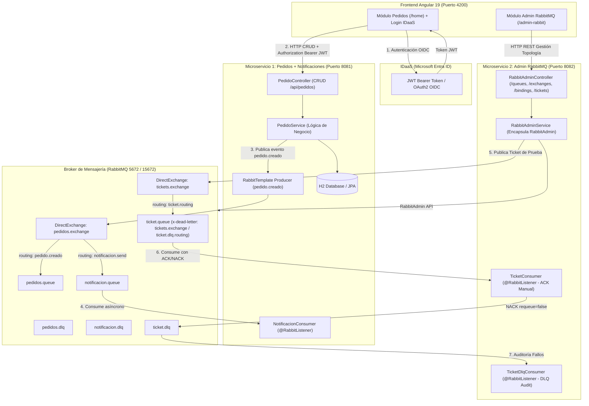

# INFORME TÉCNICO Y ENTREGABLE FINAL
## Evaluación Parcial N°3 — DSY1107 Desarrollo Cloud Native I
### Sistema de Gestión de Pedidos y Mensajería Distribuida con RabbitMQ ("Pedidos360")

---

**Asignatura:** DSY1107 Desarrollo Cloud Native I  
**Evaluación:** Evaluación Parcial N° 3  
**Repositorio GitHub:** [https://github.com/Tomasdfp/Pedidos360.git](https://github.com/Tomasdfp/Pedidos360.git)  
**Rama Principal:** `main`  

---

## 1. Resumen Ejecutivo del Proyecto

El proyecto **Pedidos360** es una solución Cloud Native distribuida compuesta por dos microservicios construidos sobre **Spring Boot 3.3.5 (Java 21)**, un frontend moderno modular en **Angular 19** con autenticación IDaaS (**Microsoft Entra ID / MSAL**), y una capa de mensajería desacoplada impulsada por **RabbitMQ**.

La solución responde a la necesidad de gestionar el ciclo de vida de pedidos comerciales de manera síncrona y emitir notificaciones y tickets asíncronos garantizando confiabilidad, tolerancia a fallos mediante colas de mensajes muertos (**DLQ - Dead Letter Queue**), confirmaciones manuales (**Manual ACK/NACK**) y una interfaz administrativa para orquestar la topología de mensajería sin reiniciar servicios.



---

## 2. Topología de Mensajería y Políticas DLQ

### 2.1. Arquitectura de Colas y Exchanges

| Componente RabbitMQ | Tipo | Propósito | Argumentos / Enrutamiento |
|---|---|---|---|
| `pedidos.exchange` | Direct | Exchange principal del negocio de pedidos | Rutea eventos de estado de pedidos |
| `pedidos.queue` | Quorum / Classic Durable | Recepción de pedidos creados | Binding: `pedidos.exchange` + `pedido.creado` |
| `notificacion.queue` | Classic Durable | Notificaciones a clientes y almacén | Binding: `pedidos.exchange` + `notificacion.send` |
| `tickets.exchange` | Direct | Exchange del servicio de soporte / tickets | Rutea tickets de soporte y mantenimiento |
| `ticket.queue` | Classic Durable | Procesamiento transaccional de tickets | `x-dead-letter-exchange: tickets.exchange`<br>`x-dead-letter-routing-key: ticket.dlq.routing` |
| `ticket.dlq` | Classic Durable | Cola de mensajes muertos para tickets fallidos | Binding: `tickets.exchange` + `ticket.dlq.routing` |

### 2.2. Mecanismo de Confirmación y Tolerancia a Fallos (ACK Manual + DLQ)

En ambos microservicios se eliminó el auto-ack por defecto. Cada consumidor toma el control explícito del canal:

```java
// TicketConsumer.java
@RabbitListener(queues = "${app.rabbitmq.queue.tickets}")
public void procesarTicket(TicketEvent event, Channel channel, 
                           @Header(AmqpHeaders.DELIVERY_TAG) long deliveryTag) throws IOException {
    try {
        if (event.isDebeFallar()) {
            throw new RuntimeException("Fallo forzado para auditoría en DLQ: " + event.getTitulo());
        }
        
        // Procesamiento exitoso
        log.info("Ticket procesado exitosamente: ID={}", event.getTicketId());
        channel.basicAck(deliveryTag, false);
        
    } catch (Exception ex) {
        log.error("Error procesando ticket {}. Enviando a DLQ...", event.getTicketId(), ex);
        // NACK sin reencolamiento (requeue = false) activa el Dead Letter Exchange
        channel.basicNack(deliveryTag, false, false);
    }
}
```

---

## 3. Catálogo de Endpoints REST

### 3.1. Microservicio 1: Pedidos (`http://localhost:8081`)

| Verbo | Ruta | Auth Requerida | Descripción | Códigos HTTP |
|---|---|:---:|---|:---:|
| `GET` | `/api/pedidos` | Bearer JWT | Lista todos los pedidos registrados | `200 OK`, `401 Unauthorized` |
| `GET` | `/api/pedidos/{id}` | Bearer JWT | Obtiene detalle de un pedido por ID | `200 OK`, `404 Not Found` |
| `POST` | `/api/pedidos` | Bearer JWT | Crea un pedido y dispara evento `pedido.creado` | `201 Created`, `400 Bad Request` |
| `PUT` | `/api/pedidos/{id}` | Bearer JWT | Actualiza información del pedido | `200 OK`, `404 Not Found` |
| `DELETE` | `/api/pedidos/{id}` | Bearer JWT | Elimina un pedido | `204 No Content`, `404 Not Found` |

### 3.2. Microservicio 2: Admin RabbitMQ (`http://localhost:8082`)

| Verbo | Ruta | Body / Parámetros | Descripción | Códigos HTTP |
|---|---|---|---|:---:|
| `POST` | `/queues` | `QueueRequestDto` (`name`, `durable`, `autoDelete`) | Declara dinámicamente una nueva cola | `201 Created`, `400 Bad Request` |
| `DELETE` | `/queues/{name}` | Path: `name` (String) | Elimina la cola indicada | `200 OK`, `404 Not Found` |
| `GET` | `/queues/{name}` | Path: `name` (String) | Inspecciona estado, mensajes y consumidores | `200 OK`, `404 Not Found` |
| `POST` | `/exchanges` | `ExchangeRequestDto` (`name`, `type`, `durable`) | Declara un Exchange (`DIRECT`, `TOPIC`, etc.) | `201 Created`, `400 Bad Request` |
| `DELETE` | `/exchanges/{name}` | Path: `name` (String) | Elimina el exchange | `200 OK` |
| `POST` | `/bindings` | `BindingRequestDto` (`queue`, `exchange`, `routingKey`) | Asocia una cola a un exchange con clave de ruteo | `201 Created`, `400 Bad Request` |
| `DELETE` | `/bindings` | `BindingRequestDto` | Desvincula una cola | `200 OK` |
| `POST` | `/tickets` | `TicketEvent` (`ticketId`, `titulo`, `debeFallar`) | Publica ticket para prueba de ACK o DLQ | `202 Accepted` |

---

## 4. Validación de Datos y Manejo de Errores

Los DTOs emplean Jakarta Bean Validation estricto para proteger la consistencia de las operaciones:

```java
public class QueueRequestDto {
    @NotBlank(message = "El nombre de la cola es obligatorio")
    @Size(min = 2, max = 255, message = "El nombre debe tener entre 2 y 255 caracteres")
    @Pattern(regexp = "^[a-zA-Z0-9._-]+$", message = "El nombre solo puede contener letras, números, puntos, guiones y guiones bajos")
    private String name;
    
    private boolean durable = true;
    private boolean autoDelete = false;
}
```

En caso de datos inválidos (por ejemplo nombre con caracteres prohibidos o vacío), el controlador intercepta `MethodArgumentNotValidException` devolviendo un `HTTP 400 Bad Request` con el detalle de las violaciones.

---

## 5. Cobertura de Pruebas Automatizadas

El microservicio `rabbit-admin-service` cuenta con una suite completa de pruebas unitarias y de integración que no dependen de un broker RabbitMQ en vivo (empleando mocks de `ConnectionFactory` y `RabbitAdmin`):

```
[INFO] -------------------------------------------------------
[INFO]  T E S T S
[INFO] -------------------------------------------------------
[INFO] Running cl.pedidos360.admin.RabbitAdminApplicationTests
[INFO] Tests run: 1, Failures: 0, Errors: 0, Skipped: 0, Time elapsed: 1.831 s
[INFO] Running cl.pedidos360.admin.RabbitAdminControllerTest
[INFO] Tests run: 4, Failures: 0, Errors: 0, Skipped: 0, Time elapsed: 0.452 s
[INFO] Running cl.pedidos360.admin.RabbitAdminServiceTest
[INFO] Tests run: 5, Failures: 0, Errors: 0, Skipped: 0, Time elapsed: 0.128 s
[INFO] Running cl.pedidos360.admin.TicketConsumerTest
[INFO] Tests run: 3, Failures: 0, Errors: 0, Skipped: 0, Time elapsed: 0.141 s
[INFO] 
[INFO] Results:
[INFO] 
[INFO] Tests run: 13, Failures: 0, Errors: 0, Skipped: 0
[INFO] 
[INFO] ------------------------------------------------------------------------
[INFO] BUILD SUCCESS
[INFO] ------------------------------------------------------------------------
```

### Casos de Prueba Verificados:
1. `testCrearColaExito()`: Creación exitosa vía `RabbitAdmin.declareQueue()`.
2. `testEliminarColaExito()`: Invocación de `RabbitAdmin.deleteQueue()`.
3. `testValidacionNombreInvalido()`: Retorno de error `400 Bad Request` cuando el DTO falla validaciones.
4. `testTicketProcesadoConAckManual()`: Ejecución normal confirma con `channel.basicAck()`.
5. `testTicketFallaYEnviaADLQConNack()`: Al lanzar excepción se ejecuta `channel.basicNack(tag, false, false)` sin reencolar, redirigiendo al Dead Letter Exchange.
6. `testTicketDlqConsumerAuditaCorrectamente()`: Verificación de procesamiento y ack en la cola muerta.

---

## 6. Guía de Ejecución y Demostración en Vivo

### Paso 1: Levantar RabbitMQ
```powershell
docker run -d --name rabbitmq -p 5672:5672 -p 15672:15672 rabbitmq:3-management
```
*(Panel web administrativo disponible en `http://localhost:15672` con credenciales `guest`/`guest`)*.

### Paso 2: Iniciar Microservicio 1 (Pedidos - Puerto 8081)
```powershell
cd c:\Users\Home\Documents\Pedidos360\backend
./mvnw spring-boot:run
```

### Paso 3: Iniciar Microservicio 2 (Admin RabbitMQ - Puerto 8082)
```powershell
cd c:\Users\Home\Documents\Pedidos360\rabbit-admin-service
./mvnw spring-boot:run
```

### Paso 4: Iniciar Frontend Angular (Puerto 4200)
```powershell
cd c:\Users\Home\Documents\Pedidos360\frontend
npm start
```

### Paso 5: Demostración Funcional
1. Acceder a `http://localhost:4200` e iniciar sesión con credenciales IDaaS.
2. Crear un nuevo pedido en la pestaña **📦 Pedidos**. Observar en la consola del backend cómo se emite `pedido.creado` y se procesa en el consumidor de notificaciones.
3. Navegar a la pestaña **🐰 Admin RabbitMQ** (`/admin-rabbit`):
   - Verificar la lista de colas del sistema y el número de mensajes en tiempo real.
   - Crear una cola personalizada (ej. `cola.auditoria.demo`) y comprobar su creación inmediata en el panel de RabbitMQ.
   - Enviar un ticket de prueba normal con el interruptor *"Simular fallo"* **desactivado**: verificar en el log que se emite `basicAck`.
   - Enviar un ticket con *"Simular fallo"* **activado**: verificar en el log que se lanza la excepción, se ejecuta `basicNack` y el mensaje es capturado por el consumidor `TicketDlqConsumer` en la cola `ticket.dlq`.

---

**Repositorio Oficial:** `https://github.com/Tomasdfp/Pedidos360.git`  
**Estado:** Listo para entrega y defensa técnica.
